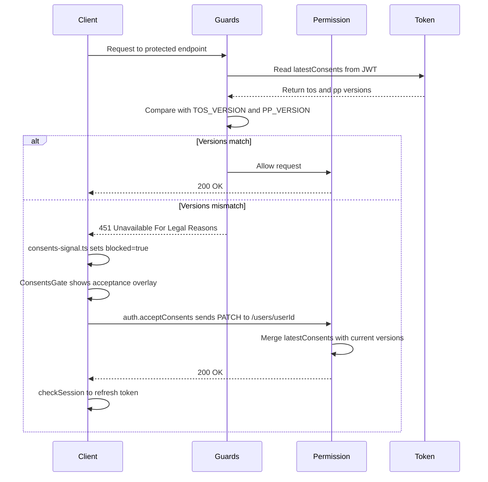

# Operations & Runbook

## Environment Configuration

**File:** `src/environments/environment.ts`

This is the single configuration file for the starter. It contains:

```typescript
export const environment = {
  apiUrl: '',
  features: {
    emailRegistration: true,
    passwordReset: true,
    oauthLogin: false, // Google sign-in: off until you create its OAuth client
    oauthProviders: ['google'] as const,
    teamInvitations: true,
  },
};
```

### apiUrl

Must be a valid Ulabase service URL (`https://<id>.ulabase.app`). The app validates this on startup with `isValidApiBaseUrl()` from `@ulabase/kit-react`. If invalid or empty, a ConfigPage is shown instead of the app.

**After cloning**, tell git to ignore local changes:

```bash
git update-index --assume-unchanged src/environments/environment.ts
```

Then edit the file to point to your own service.

### Feature Flags

See [Auth & Teams — Feature Flags](../domain/auth-and-teams.md#feature-flags) for the complete reference. These must match your Ulabase service's toggles.

The two lists are kept in step by *derivation*, not by hand: `ulabase.setup.ts` imports the same `environment` object the app imports and writes the server's configuration from it, so there is no second copy of the flags to forget. The mapping is:

| App flag in `environment.features` | Server toggle(s) |
|------------------------------------|------------------|
| `emailRegistration` | `registration` and `verification` (signing up and confirming the address are one flow) |
| `passwordReset` | `password-reset` |
| `teamInvitations` | `invitations` |
| `oauthLogin` | `oauth` |

Turning `passwordReset` off in the app and re-running the setup turns it off on the service too.

## Design System

**File:** `src/styles.css`

The stylesheet is structured in seven sections, all clearly marked with comments:

| Section | Content |
|---------|---------|
| 1. Design tokens | CSS custom properties — the single source of color, type, space, and shape |
| 2. Reset & base | Minimal reset and base element styles |
| 3. Skin classes | Component classes (`.card`, `.btn-primary`, `.form-field`, `.auth-page`, etc.) |
| 4. Auth pages | Specialized styles for authentication pages (login, signup, verify, etc.) |
| 5. Config page | Styles for the "Connect your service" configuration screen |
| 6. Responsive | Media queries for different screen sizes |
| 7. Reduced motion | Prefers-reduced-motion media query |

### Design Tokens

All colors, spacing, and typography flow from CSS custom properties in `:root`. Key tokens:

```css
--color-primary: #f8a839;       /* Ulabase amber — primary actions */
--color-link: #1f6f54;          /* Teal — links and success */
--color-bg: #f4f6f8;            /* Page background */
--color-surface: #ffffff;       /* Card/surface background */
--color-text: #14171c;          /* Primary text */
--color-text-muted: #656d7a;    /* Secondary text */
```

### The "Blueprint" Design Language

The default skin is deliberately a **mockup**, not a finished product:

- Flat, crisp surfaces — borders and typography carry the design
- Squared-off radii with a faint dot grid (drafting-sheet aesthetic)
- Small uppercase monospace for UI chrome (labels, back links)
- One accent (amber) for primary actions, teal for links/success

### Two Ways to Customize

1. **Tweak it** — change tokens in section 1, skin classes in section 3
2. **Replace it** — adopt Material / Tailwind / your own: delete sections 3–5 and reskin using the stable vocabulary of semantic class hooks (`.card`, `.btn-primary`, `.form-field`, etc.). The swap map in [NOTES.md](../../NOTES.md#swap-map) lists the complete vocabulary.

## Theming

**File:** `src/pages/shell/Shell.tsx` (contains `useTheme()` hook)

Light/dark mode is implemented as a hook in the Shell component:

```typescript
const STORAGE_KEY = 'rh-theme';

function useTheme() {
  const [dark, setDark] = useState(() => {
    if (typeof window === 'undefined') return false;
    return localStorage.getItem(STORAGE_KEY) === 'dark';
  });

  useEffect(() => {
    document.documentElement.classList.toggle('dark', dark);
  }, [dark]);

  const toggle = useCallback(() => {
    setDark(prev => {
      const next = !prev;
      document.documentElement.classList.toggle('dark', next);
      localStorage.setItem(STORAGE_KEY, next ? 'dark' : 'light');
      return next;
    });
  }, []);

  return { dark, toggle };
}
```

- Preference is persisted to `localStorage` under key `rh-theme`
- Toggling adds/removes the `dark` class on `<html>`
- Override tokens for `.dark` in `styles.css` to implement dark mode colors

The toggle button is in the user avatar dropdown menu in the Shell header.

## Build & Deploy

### Development

```bash
npm install
npm run dev      # Vite dev server with HMR
```

### Production Build

```bash
npm run build    # Runs tsc -b (type checking) then vite build
npm run preview  # Serve dist/ locally for testing
```

The build produces static files in `dist/`. Deploy this directory to any static hosting (Netlify, Vercel, Cloudflare Pages, S3+CloudFront, etc.).

### CI/CD

**File:** `.github/workflows/no-service-url.yml`

A GitHub Actions workflow ensures no real service URL is committed to main in the starter repository. The check runs only in `ulabase/starter-react` and verifies that `apiUrl` remains empty in all environment files.

## Page-Specific Stylesheets

Each page directory under `src/pages/` contains its own CSS file (e.g., `Shell.css`, `Teams.css`, `Account.css`). These hold **page-specific layout only** — all design tokens and shared styles live in `src/styles.css`.

## Consents Gate Operations

The consents gate blocks authenticated users who have not accepted the current Terms of Service and Privacy Policy. When a user's `latestConsents.tos` or `latestConsents.pp` does not match the server's current versions, the service responds with `451 Unavailable For Legal Reasons` to any authenticated request (including `/users/me`).

The client carries the gate's overlay code in every build. What makes the gate exist is the server-side Guards rule installed by `ulabase.setup.consents.ts`; with only `ulabase.setup.ts` applied, no request is ever answered `451`, so the acceptance dialog never opens. Nothing in the app switches the gate off — an unasked question is the absence of a rule on the server.



*Consents gate flow: the Guards rule compares JWT claims against the versions derived from `TOS_VERSION`/`PP_VERSION`, and the Permission stamps those same versions on acceptance.*

### Verifying the Gate

The gate is working correctly when:

1. A user who has not accepted the current versions receives `451` on `/users/me` (or any authenticated endpoint except the `/auth` and `/token` paths and the acceptance `PATCH` itself)
2. After accepting, the user's requests succeed normally
3. The `src/consents-signal.ts` client module raises the `blocked` flag on `451` responses, triggering the acceptance overlay

`ulabase setup --srv <srvId> --file ulabase.setup.consents.ts --dry-run` is the honest answer to "is this service missing anything": every step is a `check` and an `apply`, so the dry run reports exactly which of the gate's four documents are absent or out of date.

### Publishing New Terms/Privacy Versions

The version strings live in **one place in code**. `ulabase.setup.consents.ts` declares two constants and derives everything else from them — twice into the permission's `mergeRequest` (which stamps `latestConsents` and pushes onto the `consents` history) and twice into the guard rule's condition:

```typescript
const TOS_VERSION = '2026-07-01';
const PP_VERSION = '2026-07-01';
```

To publish new documents:

1. **Edit the version strings** in `ulabase.setup.consents.ts` — the two constants above.

2. **Update the HTML files** to match. This is the only step left to keep in step by hand:
   - `public/terms.html` — line 59: `<p class="version">Version 2026-07-01</p>`
   - `public/privacy.html` — line 59: `<p class="version">Version 2026-07-01</p>`

3. **Re-run the setup** to push the new versions to the service:
   ```bash
   ulabase setup --srv <srvId> --file ulabase.setup.consents.ts
   ```

4. **Verify the gate** — after setup, all users will be blocked until they accept the new versions. The acceptance overlay will appear on their next request.

No client change and no redeploy are involved: `src/consents-signal.ts` knows nothing about which versions are current. The server decides what is being accepted, so the same build simply meets a new form.

Each prior acceptance stays in the `consents` history — the permission's `mergeRequest` uses `$push` rather than overwriting — and `acceptedAt` is stamped by the server as `@now`, so a client cannot backdate an acceptance.

### Version Drift and Permanently-Blocked Users

**The failure is quiet.** The acceptance dialog appears to succeed — the `PATCH` returns `2xx`, no error is shown — but the server stamps one version while the Guards rule compares against another, and the user is blocked for ever by a form that says it worked.

Within the setup file this cannot happen: both the stamping and the comparison are derived from the same two constants. Drift that *does* bite comes from either of two places:

- **The service is not up to date with the file.** A version bump is not applied until setup is re-run, so the deployed rule and permission keep enforcing the old strings.
- **The HTML documents disagree with the constants.** `public/terms.html` and `public/privacy.html` are ordinary static files and are never read by the setup; their `Version …` lines are documentation for the human reader and must be edited alongside the constants.

**Prevention:** always update the constants and the two `public/` version lines together, then re-run setup.

**Diagnosis when a user is stuck after accepting:** `ulabase setup --srv <srvId> --file ulabase.setup.consents.ts --dry-run` reports outstanding work. Note that the two halves of the gate are not checked with the same rigour:

- The **Guards rule** step compares the rule's full `condition` text and its `status_code` against what the current constants derive. A version bump therefore shows up as work outstanding, and the re-run rewrites the rule.
- The **permission** step checks only that `userCanPatchOwnConsents` *exists*. If the permission is already present, a re-run leaves it exactly as it is — including a `mergeRequest` still stamping older versions. That is the quiet failure described above: the rule is comparing the new constants while the acceptance is stamped with the old ones.

If users report being stuck after accepting on a service where the rule was updated by hand, the permission's `mergeRequest` is the place to look — and the fix is to make the deployed permission agree with the rule again.

A second permanent-block cause is a **missing JWT claim**. The guard reads `latestConsents/tos` and `latestConsents/pp` from the token, not the database. If either claim is absent from the auth feature's `account-properties-claims`, the comparison is false for every token-authenticated user — including those who just accepted. Setup adds both claims (set-union, never replacing claims the service already had), and deliberately leaves the growing `consents` history out of the token.

### Troubleshooting by Symptom

| Symptom | What it means | What to do |
|---------|---------------|------------|
| `451 Unavailable For Legal Reasons` on `/users/me` and other authenticated calls | The consents Guards rule is refusing the request: the user has not accepted the current versions | Expected during a version bump. If it persists after accepting, see [Version Drift](#version-drift-and-permanently-blocked-users) |
| `403 Forbidden` on the acceptance `PATCH` | The **ACL** refused the request before the Guards rule ever ran — nothing authorises `PATCH /users/{userId}` out of the box | The `userCanPatchOwnConsents` permission is missing. Re-run `ulabase setup --srv <srvId> --file ulabase.setup.consents.ts` |
| `403 Forbidden` on a button the app happily rendered | **Feature-flag drift**: a feature that is off on the service answers unauthenticated callers with `403`, while the app still offers the form | The flags live once in `environment.ts`; re-run setup so the service's toggles are derived from them again. See [Feature Flags](#feature-flags) |
| Everything fails, and the console says the origin is not allowed | The origin the app is served from is not in the service's `origin-allowlist` | Re-run setup with the correct `APP_URL`, or add the origin under *Service → Origin Allowlist*. See [Origin Allowlist](#origin-allowlist) |
| The app shows the "Connect your service" ConfigPage | `apiUrl` in `src/environments/environment.ts` is empty or is not a valid Ulabase service URL | Set `apiUrl` to `https://<id>.ulabase.app`, or re-run setup so `appPointsAtService` writes it for you |
| Requests reach a service, but not the one you meant | `apiUrl` points at the **wrong host** — a stale id left over from another service | Point `apiUrl` at the right service. `appPointsAtService` rewrites only the `apiUrl` line; comments and feature flags in the file are left untouched |
| A stored OAuth client secret reads back as bullets (`•••••`) | That is a **redaction placeholder**, not a missing value — a stored secret is never printed back | Leave it alone. Setup does read-modify-write with the placeholders passed straight back so the server restores the stored value; stripping "empty-looking" fields would overwrite a real secret with bullets |
| A brand-new secret field reads back blank | A stored secret reads back as bullets; one never set reads back blank | Supply it via the environment (e.g. `GOOGLE_CLIENT_ID`/`GOOGLE_CLIENT_SECRET`) and re-run setup |

Note the `451` vs `403` distinction in particular: `451` is the **Guards** rule speaking, and means "you are authenticated but not accepted"; `403` is the **ACL** speaking and means the request was refused before any guard had a say. A guard never gets a say on a request the ACL already refused, so a missing acceptance permission looks like a plain authorization failure rather than a consents problem.

### Origin Allowlist

**Files:** `ulabase.setup.ts` (the `the app origin may call the service` step), `APP_URL` environment variable

The browser calls the service directly, so the service decides which origins it answers. `ulabase setup` installs the `origin-allowlist` feature if it is not present and adds `APP_URL` (default `http://localhost:5173`) to `allowed-origins`. The addition is **additive, never replacing** — a service reached from more than one origin (localhost and a deployed app) keeps both.

Left unset, origin filtering is permissive, which is fine on a service you are learning on and wrong everywhere else. It is also the step that gets skipped, because nothing fails until the day it matters.

If you change where the app is served from, re-run the setup with the new `APP_URL` (or add the origin under *Service → Origin Allowlist*). The same step also updates `frontend-url` and `frontend-app-url`, which is what keeps verification, reset and invitation email links from becoming dead ends.

### Feature-Flag Drift

The observable symptom of feature-flag drift is a `403` on a button the app went to the trouble of rendering: a feature that is off on the service answers unauthenticated callers with `403`.

There is no second list to reconcile by hand. `ulabase.setup.ts` reads the same `features` block the app imports and writes the service's `Sign-up Mgmt → Features` toggles from it (see the mapping in [Feature Flags](#feature-flags)), so re-running setup is the whole repair. Changing a flag in `environment.ts` and deploying the app without re-running setup is the way drift happens — the UI and the service then disagree until the next setup run.

Google sign-in is the one flag with an extra step: with `oauthLogin` on and `google` in `oauthProviders`, setup also expects `GOOGLE_CLIENT_ID` and `GOOGLE_CLIENT_SECRET` in the environment (resolved at apply time, and only when the values are not already stored, so a re-run against a configured service needs no secrets in the environment). A server with the feature enabled and no credentials answers the OAuth redirect with an error, which is worse than not offering the button.

## See Also

- [Architecture Overview](../architecture/overview.md) — component tree and config gating
- [Auth & Teams](../domain/auth-and-teams.md) — feature flag definitions
- [Service Setup](service-setup.md) — what the setup files configure and how
- [Quickstart](../quickstart.md) — getting a service configured and the app pointed at it
- [Testing Guidance](../testing/guidance.md) — running tests
