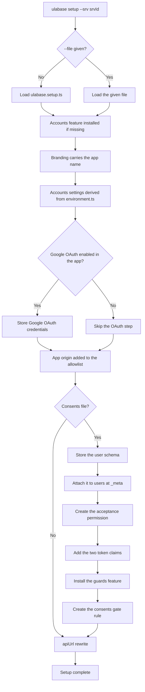

# Service Setup with Ulabase CLI

This page documents how the Ulabase React starter configures its backend service declaratively using the `ulabase` CLI. The setup is idempotent — each step checks current state before applying changes — and the feature flags flow from `src/environments/environment.ts` to the service automatically.

## CLI Installation and Authentication

The `ulabase` CLI can be installed globally or as a dev dependency:

```bash
# Global install (recommended for setup commands)
npm install -g ulabase
ulabase login                              # paste a token from ulabase.com

# Or as a dev dependency (for CI/CD pipelines)
npm i -D @ulabase/cli
```

The starter includes `@ulabase/cli` as a dev dependency in `package.json`. The CLI authenticates against Ulabase and stores a token locally; all subsequent commands use this token. The setup files are TypeScript executed directly by the CLI, which is why Node.js 22.18 or later is required to run them.

## Setup Workflow

### Basic Setup

```bash
ulabase setup --srv <srvId>                # apply all steps
ulabase setup --srv <srvId> --dry-run      # check only, report what's missing
ulabase setup --srv <srvId> --file ulabase.setup.consents.ts   # with consents gate
```

The `<srvId>` is the six-character identifier from your service URL (e.g., `abc123` in `https://abc123.ulabase.app`).

### Check, Apply, and `--dry-run`

Every step is a `check` and an `apply`. A check answers a question about the service's current state; an apply writes only what the check found missing. Running setup against a configured service writes nothing and reports each step satisfied.

`--dry-run` runs the checks and nothing else: it is the honest answer to "what is this service missing", and it never touches the service. Read it literally, though — a step is "satisfied" exactly when its check returns true, and the checks are not all equally deep. The guard rule's check compares its full condition text (so a stale rule shows up as work outstanding), while the acceptance permission's check asks only whether the permission exists (so an existing permission with old version stamps reads as satisfied).

When a check runs `apply` against a service where the work is already done, an install may answer `409 Plugin already installed`. That is the desired end state, so the base file's `install` helper (used by the accounts and origin-allowlist installs) swallows exactly that status and rethrows anything else: a forced run must not report a problem that does not exist.

### Setup Decision Tree



*Setup flow for both files: the accounts chain runs first, the consents file inserts its six gate steps before the rewrite, and the `apiUrl` rewrite runs last in every case.* The consents list filters `appPointsAtService` out of the reused base steps and re-appends it at the end, so a setup that stopped halfway leaves the "connect your service" screen rather than a sign-up page that fails.

## Base Setup File: `ulabase.setup.ts`

The base setup file (`ulabase.setup.ts`) imports `environment.ts` to derive server configuration from the app's feature flags. This eliminates configuration drift between frontend and backend: turning `passwordReset` off in the app and re-running setup turns it off on the service too, because there is no second place to forget. The setup uses `defineSetup` and `step` from `@ulabase/cli` to create idempotent check-then-apply steps.

A server feature that is off answers unauthenticated callers with `403`, so the app must not offer a button for it. The `features` block in `environment.ts` must therefore agree with the service's "Sign-up Mgmt → Features" toggles — `ulabase.setup.ts` reads these flags and configures the service so the two lists cannot drift:

```typescript
// From environment.ts
export const environment = {
  apiUrl: '',
  features: {
    emailRegistration: true,
    passwordReset: true,
    oauthLogin: false, // Google sign-in: off until you create its OAuth client
    oauthProviders: ['google'] as const,
    teamInvitations: true,
  },
};
```

The setup file derives server toggles:

```typescript
const f = environment.features;

const features = {
  registration: f.emailRegistration,
  verification: f.emailRegistration, // Covers two server flags: signup and verification
  'password-reset': f.passwordReset,
  invitations: f.teamInvitations,
  oauth: f.oauthLogin,
};
```

`emailRegistration` covers two server flags because from the app's side signing up and confirming the address are one flow: offering the form and then not verifying is not a mode anyone wants.

### Derivation Table

Everything the setup writes comes from these values. There is no second configuration surface.

| App flag or environment value | What the setup writes |
| --- | --- |
| `emailRegistration` | `accounts.features.registration` **and** `accounts.features.verification` |
| `passwordReset` | `accounts.features['password-reset']` |
| `teamInvitations` | `accounts.features.invitations` |
| `oauthLogin` | `accounts.features.oauth` |
| `APP_URL` (env; default `http://localhost:5173`, trailing slash stripped) | `accounts['frontend-url']`, `accounts['frontend-app-url']`, and an additive entry in `origin-allowlist['allowed-origins']` |
| `APP_NAME` (env; default `Ulabase Starter`) | `branding.name` — the sign-in page and every email the service sends |
| `GOOGLE_CLIENT_ID` / `GOOGLE_CLIENT_SECRET` (env) | `accounts.oauth.google` credentials, resolved with `fromEnv()` only when the service does not already hold them |

### Base Setup Steps

1. **Accounts Feature Installation** — Installs the `accounts` feature if not present. The apply goes through the shared `install` helper, which treats a `409` "already installed" response as the success it is.

2. **Branding** — Sets `name` on the `branding` feature to `APP_NAME`. Branding is a feature always on and configured like every other; because the whole configuration document is replaced, the step reads the current config first and writes it back with the name changed, so a colour or logo set in the console survives.

3. **Accounts Configuration** — Sets `frontend-url`, `frontend-app-url`, and all feature flags. The `frontend-url` determines where verification, reset, and invitation emails link to; the `frontend-app-url` is where a verified or signed-in user lands. The update is a read-modify-write that passes the server's redaction placeholders straight back — stripping "empty-looking" fields would write bullets over a real secret.

4. **Google OAuth Credentials** — Conditional step: only executes when `oauthLogin` is `true` and `oauthProviders` includes `'google'`. Uses `fromEnv()` to read `GOOGLE_CLIENT_ID` and `GOOGLE_CLIENT_SECRET` from environment variables, but only when credentials aren't already stored. Uses `isRedacted()` to detect already-stored secrets, so a re-run against a configured service needs no secrets in the environment.

5. **Origin Allowlist** — Adds the `APP_URL` to the service's allowed origins. Additive: never replaces existing origins, only adds missing ones (a service reached from localhost and a deployed app keeps both). Installs the `origin-allowlist` feature if not present.

6. **App Points At Service** (`appPointsAtService`, exported) — Always last: rewrites only the `apiUrl` line in `src/environments/environment.ts` to the service URL from `admin.serviceToken(srvId)`. Comments and flags are untouched, the step fails with an explicit error if the file has no `apiUrl: '...'` line, and it is exported so a setup that extends this one can keep it last.

## Consents Gate Setup: `ulabase.setup.consents.ts`

The consents gate file imports the base setup and appends additional steps for requiring Terms of Service and Privacy Policy acceptance. It reuses the accounts steps via `import accounts, { appPointsAtService } from './ulabase.setup.ts'` and spreads `accounts.steps.filter(s => s !== appPointsAtService)` — the accounts steps have one definition, and adding one there reaches both files. The accounts steps come first deliberately: a gate that blocks users the service cannot yet create has nothing to block, and the permission is written against the `users` collection the accounts feature owns. The gate has two halves: a server-side rule that blocks requests with `451`, and a client-side overlay (keyed on `451` in `src/consents-signal.ts`) that presents the acceptance form. The runtime side of the gate is covered in [Auth & Teams](../domain/auth-and-teams.md).

### Version Constants

```typescript
const TOS_VERSION = '2026-07-01';
const PP_VERSION = '2026-07-01';
```

These versions appear in both the permission's `mergeRequest` and the guard rule's condition. They must match exactly; mismatched versions block users permanently.

### Ordered Steps

The consents list is the reused accounts steps minus `appPointsAtService`, then the six gate steps below, then `appPointsAtService` re-appended last.

1. **User Schema** (`userConsentsSchema`) — Defines the user document shape with `latestConsents` and `consents` fields. Uses `_$date` BSON escaping for `acceptedAt`, which is a BSON date; declared as a plain string, every acceptance is rejected. `latestConsents`, `consents` and the team fields are **not** required — an invited user is written with no password and an empty profile, and a document is validated as it is inserted before the initial team is attached, so requiring them would reject every invitation and registration. `_id` and `roles` *are* required: on a `PUT /users/{id}` the id arrives in the path rather than the body, so a direct write is refused with `required key [_id] not found`, while registration through `/auth/register` sends a whole document and passes. The check does not merely ask whether a schema exists — it compares a canonical form of the stored schema against this one (sorted keys, store-added `_id`/`_etag`/`$schema`/`$id` dropped, `_$date` unescaped), so a service set up with an older version reports work outstanding and is rewritten.

2. **Users Collection Validation** — Links the schema to the `/users` collection by setting `jsonSchema.schemaId` on the collection's metadata. `/users` lists the documents; the collection's own properties live at `/users/_meta`, and the step writes them by `PATCH`-ing `/users` with `{ jsonSchema: { schemaId } }`. Reading `/users` and looking for `jsonSchema` finds nothing, for ever, however many times the apply succeeds.

3. **Permission** (`userCanPatchOwnConsents`) — Allows the `user` role to `PATCH` its own `consents` field and nothing else: the predicate is `path-template('/users/{userId}') and method(PATCH) and (equals(@user._id, ${userId}) or equals(@user.sub, ${userId})) and bson-request-whitelist(consents)`. The server stamps versions and timestamps via `mergeRequest` — `latestConsents` as a nested object (dotted keys would be refused by MongoDB with `ConflictingUpdateOperators`) and `_$push` onto the `consents` history so acceptances accumulate rather than overwrite. A client sends `{"consents": []}` and states nothing; otherwise it could accept terms it was never shown or backdate the acceptance. Without this permission the acceptance is a `403`, because nothing authorises `PATCH /users/{userId}` out of the box and a guard never gets a say on a request the ACL already refused. Its check asks only whether the permission exists — see [Bumping Consent Versions](#bumping-consent-versions).

4. **JWT Claims** — Adds `latestConsents/tos` and `latestConsents/pp` to the token payload by appending them to the `auth` feature's `account-properties-claims`. The guard reads the token, not the database: a missing claim compares false for every token-authenticated user for ever, including those who just accepted. The addition is a set-union, so claims the service already carries survive. Only these two claims are added — a JWT payload is base64, not encrypted, so everything in it is readable by anyone holding the token, and the `consents` history grows at every acceptance while no decision reads it.

5. **Guards Feature Installation** — Installs the `guards` feature if not already present, checking `isFeatureInstalled` first.

6. **Guards Rule** (`consentsGate`) — Blocks authenticated users with HTTP 451 (Unavailable For Legal Reasons) when either acceptance is missing or outdated. The condition is `not (A and B)` — blocked when *either* acceptance is missing — never `not A and not B`, which would block only the users who accepted neither. It excludes:
   - Anonymous requests (`equals(@authenticated, 'true')` must hold, so anonymous callers pass) — this replaces a hand-kept list of public paths, which is invisible until it is wrong.
   - Auth paths (`/auth/*`) and token paths (`/token/*`) — these are authenticated requests made by someone who has not accepted yet; guard them and a blocked user cannot get back in, you included.
   - The acceptance itself (`PATCH /users/{userId}` with a `bson-request-whitelist(consents)` body), made while still blocked.

   `/users/me` is deliberately **not** excluded — blocking it is what makes the gate work with no client probing, since reading the user document is the first thing any app does. The rule's `check` compares the full condition string and status code, not merely the rule's presence, so bumping a version shows up as work outstanding. The apply sets `on_error: 'allow'` so a rule that cannot be evaluated cannot lock everyone out.

7. **App Points At Service** — The same exported `appPointsAtService` step, re-appended last: the app is pointed at the service once the gate is in place too.

### Why the Gate Works Without Client Code

The client code for showing the acceptance dialog is always present. When the guard rule doesn't exist, no request returns 451, so the dialog never appears. The absence of a rule is the absence of the gate — nothing to switch off in the app: an unasked question is the absence of a rule on the server, not a flag here.

The consents file does not write the Terms or Privacy Policy documents themselves — those live in `public/` and are yours. It only decides which *versions* the service demands.

## Operational Procedures

### Bumping Consent Versions

When publishing new Terms or Privacy Policy:

1. Edit `TOS_VERSION` and/or `PP_VERSION` in `ulabase.setup.consents.ts`
2. Update the version line in `public/terms.html` and/or `public/privacy.html` — `<p class="version">Version 2026-07-01</p>`. The setup never reads those files; the line is documentation for the human reader and must be edited alongside the constants.
3. Re-run setup: `ulabase setup --srv <srvId> --file ulabase.setup.consents.ts`
4. Reconcile an existing acceptance permission (see below).

Existing users see the acceptance form again on their next request. Previous acceptances remain in the `consents` history (the permission's `mergeRequest` uses `$push` to grow the history instead of overwriting it). The guard rule's `check` compares the condition string itself, so the version bump is detected as outstanding work rather than reported as satisfied — and step 3 rewrites the rule.

**Step 4 is the part that bites.** The permission step's check asks only whether `userCanPatchOwnConsents` exists, so a re-run leaves an existing permission exactly as it is — including a `mergeRequest` still stamping the previous versions. The rule now demands the new versions while acceptance is stamped with the old ones: the form returns `2xx`, shows no error, and the user is blocked for ever. Within a single run the two documents cannot disagree (both derive from the same constants), so this failure only appears after a bump against a service that already has the permission. Make the deployed permission agree with the rule again — delete `userCanPatchOwnConsents` and re-run setup so the apply rewrites it, or correct its `mergeRequest` in the console. `--dry-run` cannot see this: the permission step reads as satisfied.

### Enabling Google Sign-in

The app starts with email and password and needs no OAuth setup. To add the Google button:

1. In the Google Cloud console, create an OAuth client of type *Web application* with the redirect URI `https://<srvId>.ulabase.app/auth/oauth/callback/google`.
2. In `src/environments/environment.ts`, set `oauthLogin: true` (`oauthProviders` already lists `'google'`).
3. Re-run setup with the client's credentials in the environment:
   ```bash
   GOOGLE_CLIENT_ID=… GOOGLE_CLIENT_SECRET=… ulabase setup --srv <srvId>
   ```
   They go to the service, never into the app. A later re-run reads them back as redaction placeholders and leaves them alone, so no secrets are needed in the environment once they are stored.

Only Google has a credentials step in the setup files. The server's `oauth` toggle follows `oauthLogin` whatever the provider list says, and no other provider's credentials are written by either setup file — those belong in the service console. Adding another provider to `oauthProviders` changes nothing on its own.

### Changing Where the App Is Served From

1. Set the `APP_URL` environment variable (default `http://localhost:5173`; a trailing slash is stripped) and re-run `ulabase setup --srv <srvId>`.

This updates `frontend-url` and `frontend-app-url` (email links and post-sign-in landing) and adds the new origin to the allowlist without removing the old one. It does not touch `apiUrl`, which is the service's own URL written by `appPointsAtService`.

### Changing the App Name

1. Set the `APP_NAME` environment variable (default `Ulabase Starter`) and re-run setup.

This sets `branding.name`, which is what the service's sign-in page and its verification, reset and invitation emails show. The branding step reads the current config first, so a colour or logo configured in the console is preserved.

## Troubleshooting

**Everything fails, and the console says the origin is not allowed.** Re-run `ulabase setup` after changing where the app is served from.

**A page is missing and its link is gone.** The feature flags in `environment.ts` must match the service's toggles. Re-running setup usually fixes this.

**`401` on a request you wrote yourself.** Use `auth.api()`, which attaches the session — a plain `fetch` doesn't.

**Users blocked permanently after accepting.** The rule compares the versions in its condition while the permission stamps the versions in its `mergeRequest`; when those disagree the acceptance form appears to work and the user stays blocked. Check three things: that a version bump was followed by step 4 of [Bumping Consent Versions](#bumping-consent-versions) (a re-run rewrites the rule but never an existing permission); that `latestConsents/tos` and `latestConsents/pp` are present in the `auth` feature's `account-properties-claims`; and that `TOS_VERSION`/`PP_VERSION` agree between the two documents. The full diagnosis lives in [Operations & Runbook](runbook.md).

**`403` on the acceptance `PATCH`.** The ACL refused the request before any guard ran. `userCanPatchOwnConsents` is missing — re-run `ulabase setup --srv <srvId> --file ulabase.setup.consents.ts`.

**A stored OAuth client secret reads back as bullets.** That is a redaction placeholder, not a missing value. Leave it alone; setup passes the placeholder back so the server restores the stored secret.

**`ulabase` runs something about OpenShift.** A different, retired tool of the same name is first in your `PATH`. `type -a ulabase` shows both.

## See Also

- [Quickstart](../quickstart.md) — clone to first sign-up, including the service creation step this page assumes.
- [Auth & Teams](../domain/auth-and-teams.md) — what the consents gate does at request time once it is installed.
- [Operations & Runbook](runbook.md) — feature-flag drift, origin allowlist failures, version drift, and per-symptom diagnosis.
- [Source Map](../source-map.md) — where `ulabase.setup.ts`, `ulabase.setup.consents.ts` and `src/environments/environment.ts` sit in the repository.
