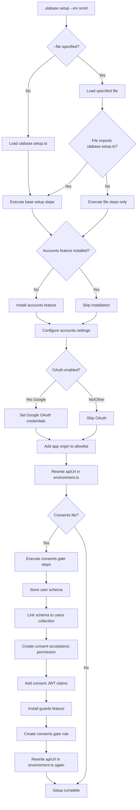

# Service Setup with Ulabase CLI

This page documents how the Ulabase React starter configures its backend service declaratively using the `ulabase` CLI. The setup is idempotent — each step checks current state before applying changes — and the feature flags flow from `environment.ts` to the service automatically.

## CLI Installation and Authentication

The `ulabase` CLI can be installed globally or as a dev dependency:

```bash
# Global install (recommended for setup commands)
npm install -g ulabase
ulabase login                              # paste a token from ulabase.com

# Or as a dev dependency (for CI/CD pipelines)
npm i -D @ulabase/cli
```

The starter includes `@ulabase/cli` as a dev dependency in `package.json` (line 21, currently `^0.13.6`). The CLI authenticates against Ulabase and stores a token locally. All subsequent commands use this token.

## Setup Workflow

### Basic Setup

```bash
ulabase setup --srv <srvId>                # apply all steps
ulabase setup --srv <srvId> --dry-run      # check only, report what's missing
ulabase setup --srv <srvId> --file ulabase.setup.consents.ts   # with consents gate
```

The `<srvId>` is the six-character identifier from your service URL (e.g., `abc123` in `https://abc123.ulabase.app`). Every step is check-then-apply: running it twice writes nothing.

### Setup Decision Tree



Decision tree for ulabase setup showing how file selection determines which configuration steps execute. The `apiUrl` rewrite runs last in both files: a setup that stopped halfway leaves the "connect your service" screen rather than a sign-up page that fails.

## Base Setup File: `ulabase.setup.ts`

The base setup file (`ulabase.setup.ts`) imports `environment.ts` to derive server configuration from the app's feature flags. This eliminates configuration drift between frontend and backend: turning `passwordReset` off in the app and re-running setup turns it off on the service too, because there is no second place to forget. The setup uses `defineSetup` and `step` from `@ulabase/cli` to create idempotent check-then-apply steps.

A server feature that is off answers unauthenticated callers with `403`, so the app must not offer a button for it. The `features` block in `environment.ts` must therefore agree with the service's "Sign-up Mgmt → Features" toggles — `ulabase.setup.ts` reads these flags and configures the service so the two lists cannot drift:

```typescript
// From environment.ts
export const environment = {
  apiUrl: '',
  features: {
    emailRegistration: true,
    passwordReset: true,
    oauthLogin: false, // Google sign-in: off until you create its OAuth client
    oauthProviders: ['google'] as const,
    teamInvitations: true,
  },
};
```

The setup file derives server toggles:

```typescript
const f = environment.features;

const features = {
  registration: f.emailRegistration,
  verification: f.emailRegistration, // Covers two server flags: signup and verification
  'password-reset': f.passwordReset,
  invitations: f.teamInvitations,
  oauth: f.oauthLogin,
};
```

### Setup Steps

1. **Accounts Feature Installation** — Installs the `accounts` feature if not present. Uses `409` response to detect "already installed" as success.

2. **Accounts Configuration** — Sets `app-name`, `frontend-url`, and all feature flags. The `frontend-url` determines where verification, reset, and invitation emails link to. Also sets `frontend-app-url` for where verified or signed-in users land.

3. **Google OAuth Credentials** — Conditional step: only executes when `oauthLogin` is `true` and `oauthProviders` includes `'google'`. Uses `fromEnv()` to read `GOOGLE_CLIENT_ID` and `GOOGLE_CLIENT_SECRET` from environment variables, but only when credentials aren't already stored. Uses `isRedacted()` to detect already-stored secrets.

4. **Origin Allowlist** — Adds the `APP_URL` (default `http://localhost:5173`) to the service's allowed origins. Additive: never replaces existing origins, only adds missing ones. Installs the `origin-allowlist` feature if not present.

5. **App Points At Service** (`appPointsAtService`, exported) — Always last: rewrites only the `apiUrl` line in `src/environments/environment.ts` to the service URL from `admin.serviceToken(srvId)`. Comments and flags are untouched, and the step is exported so a setup that extends this one can keep it last.

## Consents Gate Setup: `ulabase.setup.consents.ts`

The consents gate file imports the base setup and appends additional steps for requiring Terms of Service and Privacy Policy acceptance. It reuses the accounts steps via `import accounts, { appPointsAtService } from './ulabase.setup.ts'` and spreads `accounts.steps.filter(s => s !== appPointsAtService)` — the accounts steps have one definition, and adding one there reaches both files. The accounts steps come first deliberately: a gate that blocks users the service cannot yet create has nothing to block, and the permission is written against the `users` collection the accounts feature owns. The gate has two halves: a server-side rule that blocks requests with `451`, and a client-side overlay (keyed on `451` in `src/consents-signal.ts`) that presents the acceptance form.

### Version Constants

```typescript
const TOS_VERSION = '2026-07-01';
const PP_VERSION = '2026-07-01';
```

These versions appear in both the permission's `mergeRequest` and the guard rule's condition. They must match exactly; mismatched versions block users permanently.

### Additional Setup Steps

1. **User Schema** (`userConsentsSchema`) — Defines the user document shape with `latestConsents` and `consents` fields. Uses `_$date` BSON escaping for date fields. Note: `latestConsents` and `consents` are NOT required (they'd reject registrations).

2. **Users Collection Validation** — Links the schema to the `/users` collection by setting `jsonSchema.schemaId` on the collection's metadata (`/users/_meta`). This ensures all user documents are validated against the consents schema.

3. **Permission** (`userCanPatchOwnConsents`) — Allows users to PATCH their own `consents` field. The server stamps versions and timestamps via `mergeRequest`, preventing clients from accepting terms they weren't shown.

4. **JWT Claims** — Adds `latestConsents/tos` and `latestConsents/pp` to the token payload. The guard reads the token, not the database. These claims are additive: existing claims are preserved.

5. **Guards Feature Installation** — Installs the `guards` feature if not already present. Uses the same idempotent check-then-apply pattern as the accounts feature.

6. **Guards Rule** (`consentsGate`) — Blocks authenticated users with HTTP 451 (Unavailable For Legal Reasons) when either acceptance is missing or outdated. Excludes:
   - Anonymous requests (`@authenticated = 'false'`)
   - Auth paths (`/auth/*`)
   - Token paths (`/token/*`)
   - The acceptance itself (`PATCH /users/{userId}` with `consents` field)

The rule's `check` compares the full condition string and status code, not merely the rule's presence, so bumping a version shows up as work outstanding. The apply sets `on_error: 'allow'` so a rule that cannot be evaluated cannot lock everyone out. `/users/me` is deliberately not excluded — blocking it is what makes the gate work with no client probing, since reading the user document is the first thing any app does.

### Why the Gate Works Without Client Code

The client code for showing the acceptance dialog is always present. When the guard rule doesn't exist, no request returns 451, so the dialog never appears. The absence of a rule is the absence of the gate — nothing to switch off in the app: an unasked question is the absence of a rule on the server, not a flag here.

The consents file does not write the Terms or Privacy Policy documents themselves — those live in `public/` and are yours. It only decides which *versions* the service demands.

## Operational Procedures

### Bumping Consent Versions

When publishing new Terms or Privacy Policy:

1. Edit `TOS_VERSION` and/or `PP_VERSION` in `ulabase.setup.consents.ts`
2. Update the version lines in `public/terms.html` and `public/privacy.html`
3. Re-run setup: `ulabase setup --srv <srvId> --file ulabase.setup.consents.ts`

Existing users see the acceptance form again on their next request. Previous acceptances remain in the `consents` history (the permission's `mergeRequest` uses `_$push` to grow the history instead of overwriting it). The guard rule's `check` compares the condition string itself, so the version bump is detected as outstanding work rather than reported as satisfied.

### Adding OAuth Providers

1. Add the provider to `oauthProviders` in `environment.ts`:
   ```typescript
   oauthProviders: ['google', 'github'] as const,
   ```
2. Set the corresponding environment variables (e.g., `GITHUB_CLIENT_ID`, `GITHUB_CLIENT_SECRET`)
3. Re-run setup: `ulabase setup --srv <srvId>`

### Changing the App URL

1. Edit `APP_URL` in `ulabase.setup.ts` (or set the `APP_URL` environment variable)
2. Re-run setup: `ulabase setup --srv <srvId>`

This updates `frontend-url` (email links) and adds the new origin to the allowlist.

## Troubleshooting

**Everything fails, and the console says the origin is not allowed.** Re-run `ulabase setup` after changing where the app is served from.

**A page is missing and its link is gone.** The feature flags in `environment.ts` must match the service's toggles. Re-running setup usually fixes this.

**`401` on a request you wrote yourself.** Use `auth.api()`, which attaches the session — a plain `fetch` doesn't.

**Users blocked permanently after accepting.** Check that `TOS_VERSION`/`PP_VERSION` match between the permission's `mergeRequest` and the guard rule's condition. Re-run setup to synchronize.

**`ulabase` runs something about OpenShift.** A different, retired tool of the same name is first in your `PATH`. `type -a ulabase` shows both.
